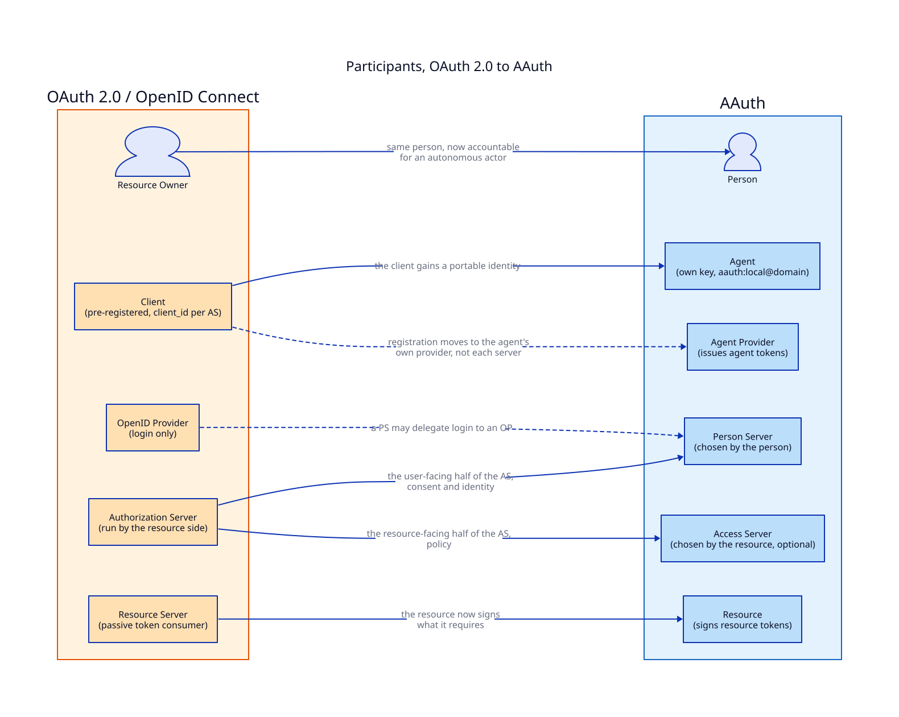
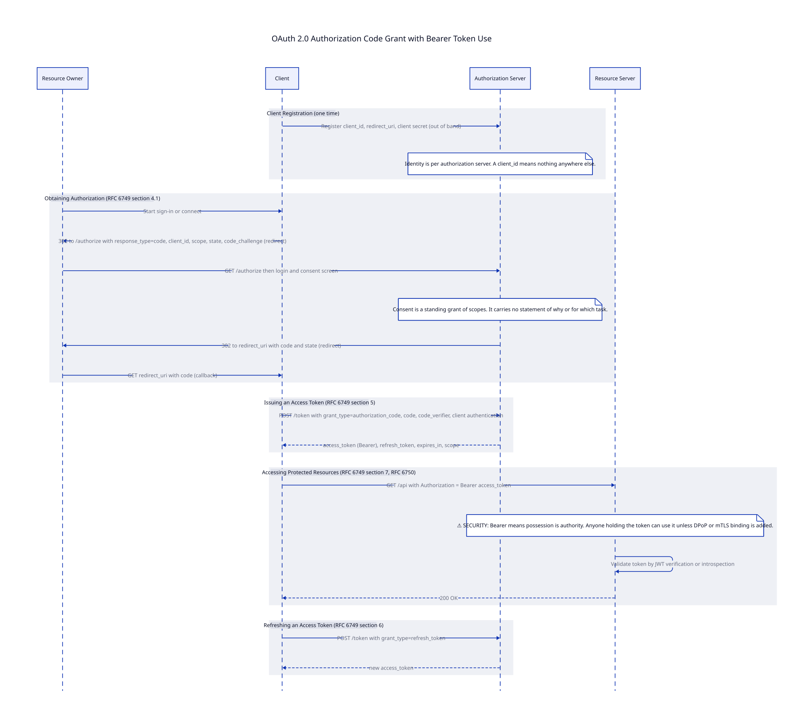
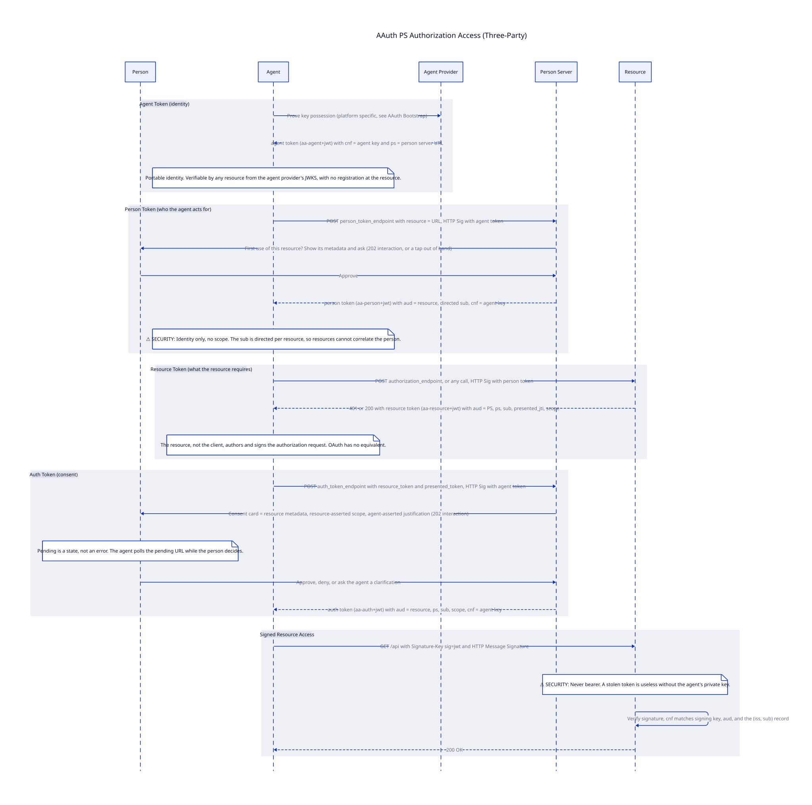
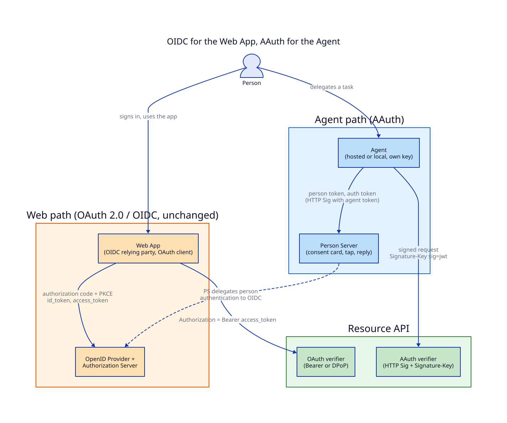

# AAuth and OAuth 2.0

AAuth is not an OAuth profile and not an OAuth replacement. It is a separate protocol for the same problem OAuth solves, delegated access to an HTTP resource, built for a client that OAuth never anticipated: an agent that assembles its own tool chain at runtime, meets services it was never registered with, and needs a human decision in the middle of a task. This page sets the two side by side. It covers the goals, the participants, the two halves of each flow, how the pieces map, what AAuth adds, what the OAuth working group is adding through drafts, and how to run both at once.

!!! note "Spec revision"
    This page tracks `draft-hardt-oauth-aauth-protocol-11` (25 September 2026), an individual Internet-Draft. Earlier drafts used different claim names (`act`, `mission`, `token_endpoint`), and older pages on this site may still show them. The diagrams here are generated from PIDL and D2 sources in `docs/aauth/diagrams/`.

## Goals

Both protocols let a person grant a piece of software access to their data at a server they do not operate. They differ in what they assume about that software.

| | OAuth 2.0 | AAuth |
|---|---|---|
| Client | An application a developer wrote, registered once, shipped | An agent that picks tools live, one call at a time |
| Client identity | Issued per authorization server, meaningless elsewhere | Self-contained, verifiable by any party |
| Credential model | Bearer by default; sender-constraining is an add-on | Every request signed; every token bound to the signing key |
| Who runs consent | The resource side's authorization server | The person's own server, chosen by the person |
| What consent means | A standing grant of scopes | Identity first, then scope, optionally bounded by a mission |
| Trust domain | One authorization server per resource | Federation between the person's server and the resource's |
| Waiting on a human | A failure | A `202` state the agent polls |
| Resource's role | Passive consumer of tokens | Signs what it requires before it serves |
| Adoption | All parties use one authorization server | Each party adopts independently; five access modes form a ladder |

OAuth's goal was to stop password sharing between web sites. AAuth's goal is to give an HTTP client the kind of identity a server already has from TLS: portable, provable, and usable at a first contact with no prior relationship.

## Participants



The OAuth roles come from RFC 6749 section 1.1. The AAuth roles come from the Terminology and Roles sections of the protocol draft.

| OAuth role | AAuth role | What moved |
|---|---|---|
| Resource owner | Person | The same person, now accountable for an actor that makes its own decisions |
| Client | Agent | Gains an identifier (`aauth:local@domain`), a signing key, and an agent token that travels with it |
| Client registration at each AS | Agent Provider | Registration happens once, with the party that issued the agent's key binding, not with each server |
| Authorization server, user-facing half | Person Server (PS) | Login, consent, identity assertion, and governance. The person picks it |
| Authorization server, resource-facing half | Access Server (AS) | Resource policy. The resource picks it. Optional: a PS can assert directly to a resource |
| OpenID Provider | Absorbed by the PS | A PS asserts who the person is. It may delegate the login itself to an OIDC provider |
| Resource server | Resource | Still enforces access, but now also issues a signed resource token describing what it needs |

The split of the authorization server is the structural change. In OAuth there is one authorization server and it belongs to the resource side. AAuth separates the half that knows the person from the half that knows the resource's policy, lets each side choose its own, and defines how they federate. OAuth has no name for this because it never needed one.

## Flows

### The OAuth names

OAuth has two halves with their own names.

- **Obtaining authorization** is an *authorization grant*. RFC 6749 defines the authorization code, implicit, resource owner password, and client credentials grants plus the refresh token grant. Extension grants added device authorization (RFC 8628), JWT bearer (RFC 7523), and token exchange (RFC 8693). The client uses the *authorization endpoint* for the user's consent and the *token endpoint* to redeem the grant.
- **Accessing protected resources** is RFC 6749 section 7 and, in practice, RFC 6750 bearer token usage: `Authorization: Bearer <token>`. DPoP (RFC 9449) and mutual TLS (RFC 8705) add sender-constraining as options.



### The AAuth names

AAuth has no grant-type taxonomy. Its organising axis is the *resource access mode*, which classifies by what the resource ends up knowing and which party established it, not by how a credential was obtained.

| Mode | Resource knows | Established by | Parties |
|---|---|---|---|
| Agent identity | Which agent | Agent Provider | Agent, Resource |
| Resource-managed (two-party) | Which person | The resource's own flow | Agent, Resource |
| Person identity | Which person | Person Server | Agent, Resource, PS |
| PS authorization (three-party) | Person and consented scope | Person Server | Agent, Resource, PS |
| Federated authorization (four-party) | Person and policy verdict | Access Server | Agent, Resource, PS, AS |

The acquisition and use halves are not sequential in AAuth. The agent runs one loop: make a signed request, read the `AAuth-Requirement` header the resource answers with, satisfy it, and retry. The requirement names the token the resource wants (`agent-token`, `person-token`, `auth-token`), an `interaction` the person must complete, or `claims` the PS must supply. The three-party flow below is the one closest to OAuth's authorization code grant.



### The same journey in both

| Step | OAuth 2.0 | AAuth |
|---|---|---|
| Before anything | Register the client, store `client_id` and secret | Agent proves key possession to its Agent Provider, receives an agent token |
| Say who is asking | `client_id` in the authorization request | Every request signed; the agent token is in `Signature-Key` |
| Say what is wanted | Client lists `scope` in the authorization request | Resource issues a signed resource token naming what it requires |
| Find out who the user is | AS login, or an OIDC `id_token` | PS issues a person token for this resource, with a directed `sub` |
| Get consent | User approves scopes at the AS consent page | PS shows the resource's own description and the agent's justification; the person approves, denies, or asks a clarification |
| Receive the credential | `access_token` from the token endpoint | `auth token` from the PS `auth_token_endpoint` (or from the AS via the PS) |
| Use it | `Authorization: Bearer` | HTTP Message Signature with the token in `Signature-Key` |
| Renew it | Refresh token grant | Re-run the loop before expiry; there is no refresh token |
| Hand it on | Token exchange (RFC 8693), actor claim | Call chaining with `upstream_token`; the PS records the chain |
| Take it back | Revocation endpoint (RFC 7009) | Revocation endpoint with cascade across PS, AS, and resource |

## How the pieces map

### Tokens

| OAuth artifact | AAuth artifact | Difference |
|---|---|---|
| `client_id` and secret | Agent token (`aa-agent+jwt`) | Issued by the agent's own provider. Binds an identifier to a key with `cnf`. Carries `ps` naming the agent's Person Server |
| ID token (OIDC) | Person token (`aa-person+jwt`) | Audience is one resource. `sub` is directed per resource so resources cannot correlate. Carries no scope |
| Authorization request parameters | Resource token (`aa-resource+jwt`) | Authored and signed by the resource, not the client. Names the PS or AS as audience, and the token the agent presented via `presented_jti` |
| Access token | Auth token (`aa-auth+jwt`) | Always key-bound. Carries `ps`, `sub`, `scope`, and `mission_s256` when under a mission |
| Access token, legacy | Session token in `AAuth-Access`, presented as `Authorization: AAuth` | Opaque. How a resource wraps its existing OAuth tokens without changing them |
| Refresh token | None | Short lifetimes and re-authorization with a refresh margin |

### Endpoints and discovery

| OAuth | AAuth |
|---|---|
| Authorization server metadata (RFC 8414) at `/.well-known/oauth-authorization-server` | Per-role metadata: `aauth-agent.json`, `aauth-person.json`, `aauth-access.json`, `aauth-resource.json` |
| Protected resource metadata (RFC 9728) | Resource metadata with `access_mode`, `authorization_endpoint`, and an R3 vocabulary (OpenAPI, MCP, gRPC, and others) |
| Authorization endpoint at the AS | `authorization_endpoint` at the resource, or a `401` carrying a resource token |
| Token endpoint at the AS | `person_token_endpoint` and `auth_token_endpoint` at the PS; `auth_token_endpoint` at the AS for federation |
| Device authorization endpoint, CIBA | `202` with `requirement=interaction`, a URL, a code, and a pending URL to poll; optional `interaction_endpoint` at the PS to relay |
| Introspection (RFC 7662) | None. All tokens are JWTs verified from the issuer's JWKS |
| Revocation (RFC 7009) | `revocation_endpoint` at the PS and AS, with a cascade |
| Dynamic client registration (RFC 7591) | None needed. The first signed call is the registration |

### Headers

| OAuth | AAuth |
|---|---|
| `Authorization: Bearer` | `Signature-Key: sig=jwt;jwt="<token>"` plus `Signature` and `Signature-Input` (RFC 9421) |
| `WWW-Authenticate` challenge | `AAuth-Requirement` on `401` or `202`; `Accept-Signature-Scheme` for the signing scheme. Both coexist with `WWW-Authenticate` |
| `DPoP` header | Not needed. Signing is the base layer, not an add-on |
| None | `AAuth-Access` (session token issuance), `AAuth-Capabilities` (what the agent can do for the user), `AAuth-Budget` (metered spend) |

## What is new in AAuth

These have no OAuth equivalent, with or without extensions.

- **Portable client identity.** `aauth:local@domain` with an agent token any party can verify from the provider's JWKS. A client_id is local to one authorization server by design.
- **Signing as the floor, not the ceiling.** The identity-only access mode replaces API keys with a signature and nothing else. Every later mode keeps the same signature and adds a token to it.
- **The resource authors the request.** A resource token is the resource saying, in signed form, what it needs before it serves. OAuth's authorization request is written by the client and the resource server never sees it.
- **Directed identifiers by default.** A person token's `sub` is unique per resource. OIDC has pairwise subject identifiers as an option; AAuth makes it the rule.
- **A person server the person chooses.** The user-facing half of authorization is decoupled from the resource and federates with the resource's access server without bilateral setup.
- **Pending as a protocol state.** A `202 Accepted` with `requirement=interaction` and a pending URL. The person can answer hours later, from a tap on a notification, with no consent page visited.
- **Interaction chaining.** When a downstream resource needs the person, the requirement propagates back through intermediaries to the agent that can reach them.
- **Governance.** Missions (an approved Markdown statement of intent, hashed and referenced by every token under it), a permission endpoint for actions no resource governs, an audit endpoint, and a clarification chat during consent.
- **Content-addressed authorization detail (R3).** The resource's description of an operation lives in a document the PS and AS fetch and hash into the token. The agent carries a hash it cannot resolve. RAR carries the detail inline where the client can read it.
- **Budgets and events.** Companion drafts add spending ceilings for metered resources and event delivery to agents through their provider.
- **A ladder, not a cliff.** A resource that only verifies signatures is already in the protocol. Adding a PS, then an AS, is additive and needs no coordination with the agent side.

## What OAuth can gain through drafts

Most of the individual mismatches have an OAuth-side answer in an RFC or a draft. The table lists them with what each covers and what stays missing. The AAuth draft itself is filed in the OAuth working group's namespace, so the two tracks are in the same room.

| Gap | OAuth answer | Status | What it covers | What stays missing |
|---|---|---|---|---|
| Bearer tokens | DPoP (RFC 9449), mutual TLS (RFC 8705) | RFC | Binds an existing token to a key | Needs a token first; cannot identify a client at first contact |
| No client identity at a new server | Dynamic Client Registration (RFC 7591); Client ID Metadata Document (`draft-ietf-oauth-client-id-metadata-document`) | RFC; Internet-Draft | Register on the fly; use a URL as `client_id` with metadata behind it | A different `client_id` per server, or a URL that still needs a registration step and a secret |
| Client authenticity | Attestation-Based Client Authentication (`draft-ietf-oauth-attestation-based-client-auth`) | Internet-Draft | A client proves which software it is through an attester | Per-AS trust in the attester; no portable identifier |
| Signed requests | HTTP Message Signatures (RFC 9421); Signature-Key header (`draft-hardt-httpbis-signature-key`) | RFC; Internet-Draft | Sign any HTTP request with a conveyed key | OAuth does not use it; AAuth is built on it |
| Rich authorization detail | Rich Authorization Requests (RFC 9396); Transaction Authorization Challenge (`draft-rosomakho-oauth-txn-challenge`) | RFC; Internet-Draft | Structured detail; the resource can author it in a challenge | Inline and readable by the client; no content addressing, no size limit beyond the token |
| Step-up mid-session | Step-up Authentication Challenge (RFC 9470) | RFC | Resource asks for a stronger authentication | Authentication only, not consent, and not deferred |
| Waiting on the user | Device Authorization Grant (RFC 8628); CIBA (OpenID) | RFC; OpenID spec | Out-of-band approval with polling | Only at the token endpoint, not from a resource mid-call |
| Acting on behalf of | Token Exchange (RFC 8693); On-Behalf-Of User Authorization for AI Agents (`draft-oauth-ai-agents-on-behalf-of-user`) | RFC; Internet-Draft | `act` chains; a `requested_actor` and `actor_token` for agents | Still bearer; still per-AS registration; no path for a downstream consent to reach the user |
| Workload to API within an org | Identity Assertion Authorization Grant, ID-JAG (`draft-ietf-oauth-identity-assertion-authz-grant`); Transaction Tokens (`draft-ietf-oauth-transaction-tokens`) | Internet-Drafts | Exchange an identity assertion for an access token; carry context across services | Single enterprise trust domain; the IdP is the one authorization server |
| Agent-specific profiles | Agent Authorization Profile (`draft-aap-oauth-profile`); Agents Native Authorization via Structured Elicitation (`draft-embesozzi-oauth-agent-native-authorization`); AI Agent Authentication and Authorization (`draft-klrc-aiagent-auth`) | Internet-Drafts | Profiles and gap analyses applying OAuth to agents | Each keeps the OAuth trust topology: the resource side's AS, pre-registered clients |
| Resource discovery | Protected Resource Metadata (RFC 9728) | RFC | Where the AS is and what scopes exist | No access mode, no operation vocabulary, no resource signing key |
| A fresh start | GNAP (RFC 9635) | RFC | Proof-of-possession by default, no pre-registration, async authorization | Resource is still a passive consumer; continuation is single-client; the client talks to each AS directly |

Taken together these close the per-token holes. They do not change the topology: one authorization server, owned by the resource side, with clients registered to it. That topology is what the next section is about.

See the [ID-JAG section](../idjag/protocol-overview.md) for the enterprise-internal case, where a single IdP is exactly what you want.

## Why extensions are not enough

The protocol draft's own rationale section lists six assumptions it would have to break to extend OAuth. Each is a foundation, not a parameter.

1. **Client identity is not portable.** A `client_id` is issued by one authorization server and means nothing elsewhere. Dynamic registration gives the agent a new identity at every server, which is the problem restated.
2. **Pre-registration precedes the first call.** An agent calls resources it has never heard of. Any scheme that needs a registration step before the first request forces every agent to register with every server.
3. **Tokens are bearer.** DPoP binds a token, but the first credential the client presents is still a shared secret or nothing. AAuth starts from a signature, so there is no unbound credential at any point.
4. **The resource has no identity.** OAuth never asks the resource server to sign anything. A signed resource token, which lets the resource state what it needs and lets the PS verify who asked, has no place in the OAuth message set.
5. **There is no governance layer.** Missions, permission checks, audit, and interaction relay would each be a separate extension with no shared model of who the person is or what they approved.
6. **The authorization server belongs to the resource.** OAuth cannot express a person-chosen server that federates with a resource-chosen one. GNAP shares several of AAuth's goals and still keeps this topology.

Two further points come from how agents behave rather than from the protocol text. Consent lands on human timelines, and in OAuth a request either succeeds or fails, so pending is an error. And scope is standing permission (`mail.read` for any reason until expiry) while an agent operates under intent, which is what a mission encodes and a scope cannot.

## Using them together

AAuth does not ask you to retire OAuth. Four patterns cover most deployments. They compose.

### OIDC for the web app, AAuth for the agent



The person uses a web app and also delegates tasks to an agent. The web app stays an OIDC relying party and OAuth client, unchanged. The agent carries its own key and talks to the person's Person Server. The resource API accepts both: an OAuth verifier for bearer or DPoP tokens, and an AAuth verifier for signed requests. Both verifiers resolve to one canonical identity that the handler reasons about. The [Hybrid Authentication guide](../guides/hybrid-authentication.md) shows the `bridge` package doing exactly this in Go.

The link between the two paths is the Person Server. A PS has to know who the person is, and the protocol says nothing about how. Delegating that to an OpenID Provider, often the same one the web app already uses, means one login, one account, and an agent identity bound to it.

### A resource wraps its existing OAuth

The resource-managed access mode exists for this. The resource keeps its consent screens, its authorization server, and its access tokens. When an agent calls, the resource runs its existing flow behind a `202` interaction, then returns the token it would have issued anyway, opaquely, in the `AAuth-Access` header. The agent presents it back as `Authorization: AAuth`, and because the request is also signed, the token can no longer be replayed as a bare bearer credential. No PS and no AS are involved. This is the first step on the resource adoption ladder and needs nothing from the identity side.

### A Person Server delegates login to OIDC

The AAuth draft defines what a PS serves to agents, not how it authenticates the person. A production PS is usually an OpenID Provider as well, or sits behind one. The person token's `sub` is then a directed identifier derived from the OIDC account, and the person approves agent requests with the same session they use everywhere else. The protocol's `login_hint` and `account` parameters exist so an agent can say which account it means when the PS fronts several.

### ID-JAG inside, AAuth across

Inside one organisation, a workload that needs an API on behalf of a user is well served by ID-JAG: the enterprise IdP is the one authorization server, and an identity assertion is exchanged for an access token. The trust-domain edge is where that stops. An agent that leaves the organisation, or one that was never inside it, needs the four-party AAuth flow: the person's PS federates with the resource's AS. The `bridge` package verifies both and the [migration guide](../guides/oauth-to-agent-migration.md) covers routing by risk.

### Which one, when

| Situation | Use |
|---|---|
| A person signs in to a web or mobile app | OIDC |
| An app calls an API on the user's behalf after an explicit click | OAuth 2.0, with DPoP if the token leaves the server |
| A workload calls an internal API for a signed-in user, one IdP | ID-JAG or transaction tokens |
| A client needs a per-instance identity instead of an API key | AAuth agent identity access |
| An agent decides what to call, at services it was not registered with | AAuth person identity or three-party access |
| An agent crosses an organisational boundary | AAuth four-party access |
| The user must approve something mid-task, maybe hours later | AAuth interaction, or a resource-managed `202` |
| The resource wants to describe an operation the user is approving | AAuth R3; RAR if staying in OAuth |

## Regenerating the diagrams

The sequence diagrams are PIDL sources compiled to D2, then to SVG. The architecture diagrams are hand-written D2. Both themes are embedded in each SVG so they follow the site's light and dark modes.

```bash
cd docs/aauth/diagrams
./build.sh
```

The script requires `pidl` v0.7.0 or later and `d2`.

## References

- [AAuth Protocol](https://datatracker.ietf.org/doc/draft-hardt-oauth-aauth-protocol/), `draft-hardt-oauth-aauth-protocol`
- [HTTP Signature Keys](https://datatracker.ietf.org/doc/draft-hardt-httpbis-signature-key/), `draft-hardt-httpbis-signature-key`
- [AAuth R3](https://datatracker.ietf.org/doc/draft-hardt-aauth-r3/), [Bootstrap](https://datatracker.ietf.org/doc/draft-hardt-aauth-bootstrap/), [Budgets](https://datatracker.ietf.org/doc/draft-hardt-aauth-budgets/), [Events](https://datatracker.ietf.org/doc/draft-hardt-aauth-events/)
- [RFC 6749](https://www.rfc-editor.org/rfc/rfc6749) OAuth 2.0, [RFC 6750](https://www.rfc-editor.org/rfc/rfc6750) Bearer Token Usage, [RFC 7636](https://www.rfc-editor.org/rfc/rfc7636) PKCE
- [RFC 8693](https://www.rfc-editor.org/rfc/rfc8693) Token Exchange, [RFC 9396](https://www.rfc-editor.org/rfc/rfc9396) RAR, [RFC 9449](https://www.rfc-editor.org/rfc/rfc9449) DPoP, [RFC 9470](https://www.rfc-editor.org/rfc/rfc9470) Step-up, [RFC 9728](https://www.rfc-editor.org/rfc/rfc9728) Protected Resource Metadata
- [RFC 9421](https://www.rfc-editor.org/rfc/rfc9421) HTTP Message Signatures, [RFC 9635](https://www.rfc-editor.org/rfc/rfc9635) GNAP
- [Identity Assertion Authorization Grant](https://datatracker.ietf.org/doc/draft-ietf-oauth-identity-assertion-authz-grant/), [Client ID Metadata Document](https://datatracker.ietf.org/doc/draft-ietf-oauth-client-id-metadata-document/), [Transaction Tokens](https://datatracker.ietf.org/doc/draft-ietf-oauth-transaction-tokens/), [On-Behalf-Of User Authorization for AI Agents](https://datatracker.ietf.org/doc/draft-oauth-ai-agents-on-behalf-of-user/)
- [AAuth Overview](overview.md), [Getting Started](getting-started.md), [Hybrid Authentication](../guides/hybrid-authentication.md)
