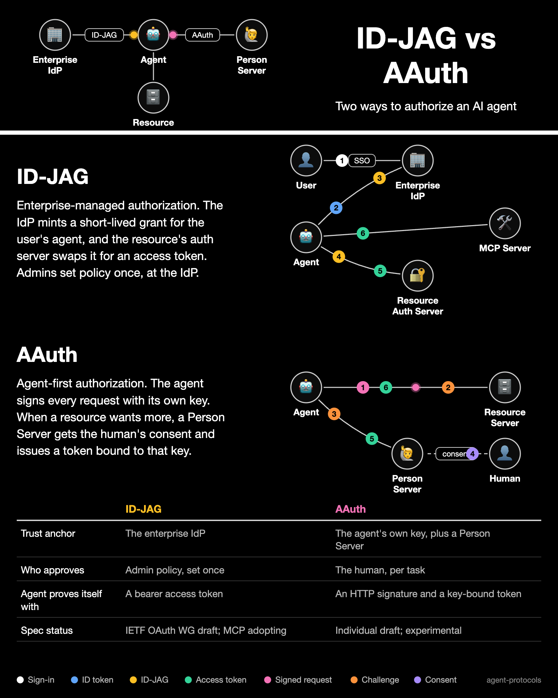

# ID-JAG vs AAuth Infographic

An animated datasheet-style card comparing [ID-JAG](../idjag/protocol-overview.md) and [AAuth](../aauth/overview.md), sized for social posts.



| File | Description |
|------|-------------|
| [`idjag-vs-aauth.card.json`](idjag-vs-aauth.card.json) | Source of truth: the card definition |
| `idjag-vs-aauth.svg` | Animated SVG (open in a browser to watch the dots move) |
| `idjag-vs-aauth.png` | 2x static image, captured 0.6 s into the loop |
| `idjag-vs-aauth.gif` | Looping GIF, for platforms that need one |

The SVG, PNG and GIF are generated. Edit the card definition and regenerate; do not edit them by hand.

## Regenerate

The card is rendered with [d2vision](https://github.com/grokify/d2vision) v0.3.0 or later. PNG and GIF output needs Chrome or Chromium.

```bash
go install github.com/grokify/d2vision/cmd/d2vision@v0.3.0

cd docs/diagrams
d2vision card render idjag-vs-aauth.card.json \
  --svg idjag-vs-aauth.svg \
  --png idjag-vs-aauth.png --scale 2 --at 0.6
d2vision svg2gif idjag-vs-aauth.svg -o idjag-vs-aauth.gif
```

If Chrome cannot start because your shell is itself sandboxed (some CI containers and agent sandboxes), add `--chrome-no-sandbox` to both commands.

Rendering is deterministic: regenerating with the same d2vision version on the same machine gives byte-identical files. Chrome version and installed fonts can change PNG and GIF output slightly across machines.

## How it is built

The ID-JAG and AAuth panels are derived from the protocol definitions in this repo, so the direction and order of every arrow come from them rather than being drawn by hand:

- ID-JAG: [`idjag/pidl/idjag_delegation.json`](https://github.com/aistandardsio/agent-protocols/blob/main/idjag/pidl/idjag_delegation.json)
- AAuth: [`aauth/pidl/resource_managed.json`](https://github.com/aistandardsio/agent-protocols/blob/main/aauth/pidl/resource_managed.json)

Each panel shows a subset of the protocol, chosen in the card definition. A step that does not exist in the protocol file, or that contradicts its order, fails the render, and `d2vision` warns about any step the protocol file does not back. This card currently renders with no warnings.

These parts are hand-written and are not checked against the protocol files, so review them against the specs when they change:

- the header overview diagram
- the panel text
- the comparison table

The numbered badges show the order of steps within a panel; the two panels animate side by side, and the loop length is derived from the steps.
